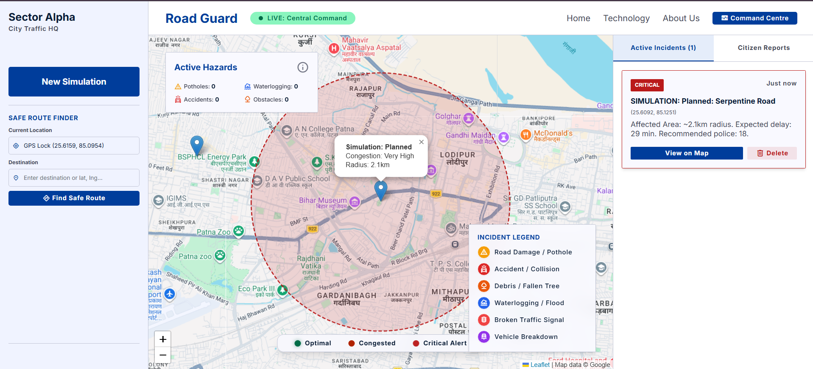
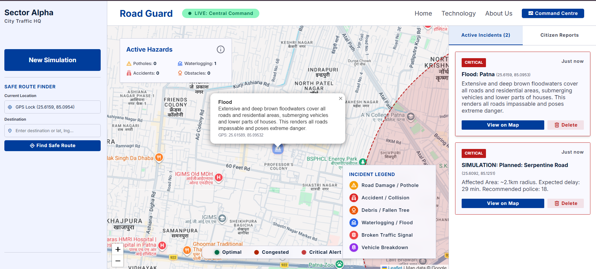
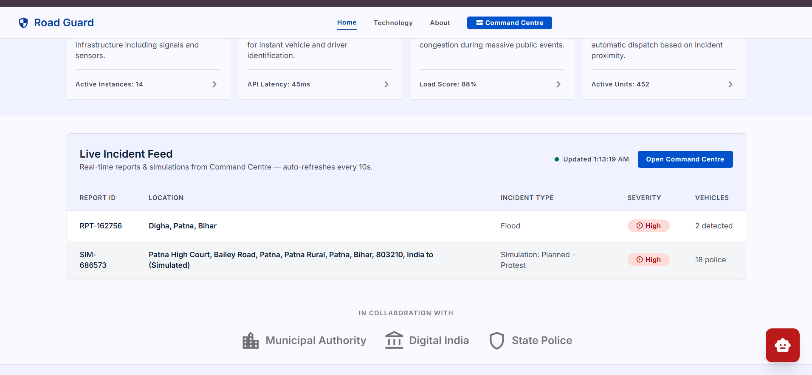
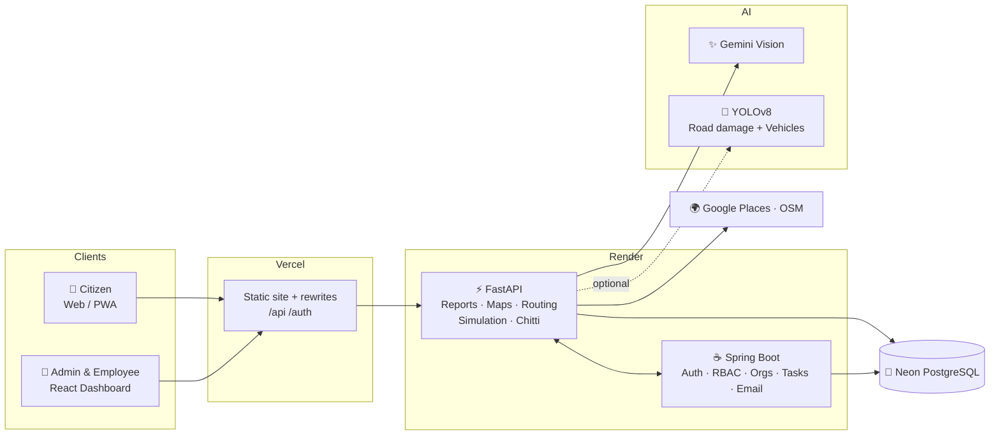
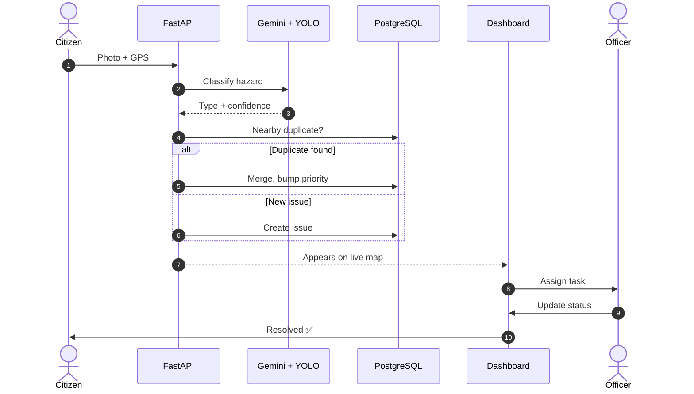

<div align="center">


### 🛡️ *See the road. Predict the chaos. Act before it happens.*

<p>
  
  
  
  
  
  
</p>
<p>
  
  
  
  
  
  
</p>

<p>
  <a href="https://flipkart-xi-blue.vercel.app"><b>🌐 Live Demo</b></a> &nbsp;•&nbsp;
  <a href="#-features"><b>✨ Features</b></a> &nbsp;•&nbsp;
  <a href="#-architecture"><b>🏗️ Architecture</b></a> &nbsp;•&nbsp;
  <a href="#-quick-start"><b>⚡ Quick Start</b></a> &nbsp;•&nbsp;
  <a href="#-api-reference"><b>📡 API</b></a> &nbsp;•&nbsp;
  <a href="#-the-team"><b>👥 Team</b></a>
</p>

</div>

---

<div align="center">





</div>

---

## 🚦 The Problem

Indian cities lose **hours of productivity, fuel and lives** to traffic that authorities only hear about *after* it has already jammed. Potholes sit unreported for months. Rallies, festivals and match days cause predictable gridlock that nobody plans for. Complaints get lost between departments.

## 💡 The Solution

**Road Guard** turns a city's roads into a living, self-reporting system:

> 📸 Citizens snap a photo &nbsp;→&nbsp; 🤖 AI verifies the hazard &nbsp;→&nbsp; 🗺️ It lands on a live map &nbsp;→&nbsp; 👮 The right officer gets the task &nbsp;→&nbsp; ✅ It gets fixed and closed.

…and before big events even start, it **predicts the congestion** and tells authorities exactly how many officers, barricades and ambulances to deploy and which diversion to open.

---

## ✨ Features

<table>
<tr>
<td width="50%" valign="top">

### 📷 Citizen Hazard Reporting
- Upload a **photo or video** with automatic **GPS**
- AI classifies: **pothole · fallen tree · flood · road debris · broken signal · accident**
- **Duplicate detection** merges nearby reports of the same issue (haversine distance)
- Every extra report **raises the issue's priority score**
- Mobile-first, installable as a **PWA**

</td>
<td width="50%" valign="top">

### 🧠 AI Verification
- **Gemini Vision** multimodal analysis of every upload
- **YOLOv8** road-damage model: longitudinal, transverse & alligator cracks, potholes
- Auto-verified issues skip the queue and hit the dashboard instantly
- Graceful **Gemini-only fallback** when YOLO is too heavy for the host

</td>
</tr>
<tr>
<td width="50%" valign="top">

### 🗺️ Live Command Map
- Interactive **Leaflet** map of every active issue
- Colour-coded priority markers & **red congestion zones**
- Road closures, citizen reports and camera alerts in one view
- **Google Places** destination search with live suggestions
- Search locations by name or six-digit Indian PIN code in the Command Center route finder

</td>
<td width="50%" valign="top">

### 🔮 Event Congestion Predictor
Enter an event (rally, festival, match), location, time and crowd size, get:
- **Congestion level** (Moderate → Very High)
- **Expected delay** in minutes
- **Affected radius** in km
- **Risk %**
- Recommended **police, barricades, ambulances, traffic marshals**
- An automatic **diversion route**

</td>
</tr>
<tr>
<td width="50%" valign="top">

### 🧭 Safe Routing
- Road-following routes via **OpenStreetMap**
- Routes **avoid active closures & reported hazards**
- "Google-Maps-style" diversion when a road shuts

</td>
<td width="50%" valign="top">

### 🤖 Chitti, the AI Assistant
- Ask: *"What should I do at Silk Board?"*
- Location-aware answers on congestion, deployment and clearance time
- Powered by **Gemini** with a **local fallback brain** so it never goes silent
- Embedded on the public site **and** the admin dashboard

</td>
</tr>
<tr>
<td width="50%" valign="top">

### 🏢 Organisation Admin Portal
- Multi-organisation, **department-based** structure
- **Role-based access control** with designation permissions
- Assign issues as **tasks** to employees with full **status history**
- Automatic **overdue-issue email reminders**
- **Audit logs**, notifications, analytics & reports

</td>
<td width="50%" valign="top">

### 🔐 Security First
- **JWT** auth, Spring Security, **Google Sign-In**
- **OTP-based password reset** over email
- Strict **CORS**, trusted hosts, 50 MiB request cap
- Security headers (HSTS, nosniff, frame-ancestors, Permissions-Policy)
- Parameterised SQL everywhere, no secrets in Git

</td>
</tr>
</table>

### 📊 Admin Dashboard Pages

| | | | |
|---|---|---|---|
| 📈 Overview | 🛠️ Issue Management | 🗺️ Live Issue Map | ✅ Resolved Issues |
| 👷 Employee Management | 🏬 Departments | 🔑 Access Control | 📋 Task Assignments |
| 📊 Analytics & Reports | 🧾 Audit Logs | 🔔 Notifications | 🙋 User Reports |
| ⚙️ Organisation Settings | 👤 Admin Profile | 🪪 Employee Portal | 🤖 Chitti Assistant |

---

## 🏗️ Architecture



### 🔄 The Report Lifecycle



---

## 🧱 Tech Stack

| Layer | Technology |
|---|---|
| **Public site** | HTML5, vanilla JS, responsive CSS, installable PWA (service worker + manifest) |
| **Admin UI** | React 19, Vite, React Router 7, React-Leaflet, Recharts |
| **Python API** | FastAPI, Uvicorn, Pydantic, psycopg 3 |
| **Org API** | Spring Boot 3 (Java 17), Spring Security, JPA, JWT (jjwt), Spring Mail, Actuator |
| **AI / ML** | Google Gemini Vision, Ultralytics YOLOv8, OpenCV, Pillow, NumPy |
| **Data** | PostgreSQL (Neon, pooled), photos stored as `BYTEA` |
| **Maps** | Leaflet, OpenStreetMap routing, Google Places |
| **DevOps** | Docker, Render Blueprint, Vercel rewrites, health checks |

---

## 🤖 ML Models

| Module | Path | What it does |
|---|---|---|
| 🕳️ **Pothole detector** | `ml_models/potholes/` | Dataset download, YOLO training scripts and Colab notebooks |
| 🚗 **Vehicle counter** | `ml_models/traffic_density/` | Counts cars, motorcycles, buses, trucks and bicycles for density and congestion index |
| 🌳 **Fallen trees** | `ml_models/fallen_trees/` | YOLO training pipeline |
| ✨ **Gemini Vision** | `ml_models/gemini_vision/` | Zero-shot hazard analysis: tree, flood, debris, signal, accident, pothole |
| 🛣️ **Road Damage Scanner** | `RoadDamageDetection-main/` | Streamlit app: realtime, image and video detection of cracks & potholes |

Bundled weights: `yolov8n.pt` (vehicles) and `RoadDamageDetection-main/models/YOLOv8_Small_RDD.pt` (road damage).

---

## ⚡ Quick Start

### Prerequisites
`Python 3.10+` · `Node 18+` · `Java 17` + Maven · `PostgreSQL` (or a Neon URL)

### 1️⃣ Configure

```bash
cp .env.example .env
# set DATABASE_URL, and optionally GEMINI_API_KEY / GOOGLE_MAPS_API_KEY / MAIL_*
```

### 2️⃣ Python API (port 8001)

```bash
pip install -r backend/requirements.txt
uvicorn backend.app:app --host 0.0.0.0 --port 8001
```

### 3️⃣ Spring organisation API (port 8083)

```bash
cd roadguard-admin/backend
mvn spring-boot:run
```

### 4️⃣ Admin dashboard

```bash
cd roadguard-admin/dashboard
npm ci
npm run dev
```

### 5️⃣ Open it

| Page | URL |
|---|---|
| 🏠 Home | `http://localhost:8001/` |
| 🎛️ Command Center | `http://localhost:8001/command.html` |
| 🛠️ Admin | `http://localhost:8001/admin` |
| 📱 PWA shell | `http://localhost:8001/webapp/` |
| 📖 Swagger docs | `http://localhost:8001/docs` |

### 🛣️ Optional: Road Damage Streamlit demo

```bash
cd RoadDamageDetection-main
pip install -r requirements.txt
streamlit run Home.py
```

---

## 📡 API Reference

<details>
<summary><b>📸 Reports &amp; Issues</b></summary>

| Method | Endpoint | Purpose |
|---|---|---|
| `POST` | `/api/report/submit` | Submit a citizen report (photo/video + GPS) |
| `GET` | `/api/issues` | All issues sorted by priority |
| `GET` | `/api/issues/{id}` | One issue with all photos |
| `POST` | `/api/issues` | Create an issue (with duplicate detection) |
| `POST` | `/api/issues/{id}/report` | Add a report and merge duplicates |
| `POST` | `/api/issues/{id}/resolve` | Mark resolved |
| `GET` | `/api/map/markers` | Active markers for the map |
| `GET` | `/api/system/events` | Durable activity log |

</details>

<details>
<summary><b>🧠 AI &amp; Prediction</b></summary>

| Method | Endpoint | Purpose |
|---|---|---|
| `POST` | `/api/gemini/analyze/upload` | Analyse an uploaded image |
| `POST` | `/api/gemini/analyze/base64` | Analyse a base64 image |
| `GET` | `/api/gemini/categories` | Supported hazard categories |
| `POST` | `/api/simulation/predict` | Congestion and resource prediction |
| `POST` | `/api/chat` | Chat with Chitti |
| `GET` | `/api/chitti/query` | One-shot Chitti question |

</details>

<details>
<summary><b>🗺️ Maps &amp; Routing</b></summary>

| Method | Endpoint | Purpose |
|---|---|---|
| `GET` | `/api/maps/suggestions` | Destination autocomplete |
| `GET` | `/api/maps/place/{id}` | Resolve a place |
| `POST` | `/api/routes/safe` | Route avoiding closures and hazards |

</details>

<details>
<summary><b>🧰 Utility</b></summary>

| Method | Endpoint | Purpose |
|---|---|---|
| `GET` | `/health` | Health check |
| `GET` | `/api/stats` | Model and system state |
| `POST` | `/api/bug-reports` | Submit a website bug report (emailed) |

</details>

---

## 🎬 Example: Predicting a Rally

```jsonc
// POST /api/simulation/predict
{ "event_type": "Political Rally", "start_point": "MG Road Junction", "time": "17:00", "crowd_size": 12000 }
```

```
┌──────────────────────────────────────────┐
│  🔴 Congestion      VERY HIGH            │
│  ⏱️  Expected delay  ~28 min              │
│  📍 Affected radius  ~3 km               │
│  ⚠️  Risk            92%                  │
├──────────────────────────────────────────┤
│  👮 Police 18   🚧 Barricades 4           │
│  🚑 Ambulance 1  🦺 Marshals 6            │
│  ↪️  Diversion → Route B                  │
└──────────────────────────────────────────┘
```
*(Figures vary with crowd size. The predictor is currently rule-based, see Roadmap.)*

---

## 🗂️ Project Structure

```
Flipkart/
├── index.html · command.html · about.html · technology.html   # Public site
├── site-chitti.js · responsive.css                            # Shared assistant + styles
├── backend/                  # ⚡ FastAPI service (app.py, schema.sql)
├── roadguard-admin/
│   ├── backend/              # ☕ Spring Boot org API (Docker-ready)
│   ├── dashboard/            # ⚛️ React + Vite admin & employee UI
│   └── sigin and signup/     # Standalone auth pages
├── roadguard-webapp/         # 📱 Installable PWA shell
├── ml_models/                # 🤖 potholes · traffic_density · fallen_trees · gemini_vision
├── RoadDamageDetection-main/ # 🛣️ Streamlit YOLOv8 road-damage scanner
├── scripts/                  # Vercel output builder
├── render.yaml · vercel.json # ☁️ Deployment blueprints
└── SECURITY_DEPLOYMENT.md    # 🔐 Production hardening checklist
```

---

## ☁️ Deployment

| Service | Platform | Config |
|---|---|---|
| Frontend + admin UI | **Vercel** | `vercel.json` (rewrites `/api` and `/auth` to the API) |
| Python API | **Render** (Docker) | `render.yaml` → `road-guard-backend` (Docker image builds the admin dashboard) |
| Spring org API | **Render** (Docker) | `render.yaml` → `road-guard-org-api` |
| Database | **Neon PostgreSQL** | `DATABASE_URL` / `SPRING_DATASOURCE_*` |

Full production checklist (CORS, trusted hosts, secrets, MFA, rate limits): see [`SECURITY_DEPLOYMENT.md`](SECURITY_DEPLOYMENT.md).

> 🔑 **Never commit secrets.** Set `GEMINI_API_KEY`, `GOOGLE_MAPS_API_KEY`, `GOOGLE_CLIENT_ID` and `MAIL_*` in your host's environment settings.

---

## 🛣️ Roadmap

- [x] Citizen reporting with GPS, photos and duplicate merging
- [x] Gemini + YOLO hazard verification
- [x] Live map, safe routing, event congestion predictor
- [x] Org portal with RBAC, tasks, audit logs, email reminders
- [x] Chitti assistant (Gemini + local fallback)
- [x] Installable PWA
- [ ] 🧠 Replace the rule-based predictor with a model trained on historical traffic and event data
- [ ] 📹 Live CCTV ingestion: vehicle counting, speed estimation and congestion index in production
- [ ] 🕸️ Camera graph network (Dijkstra / GNN) for cross-camera alerts
- [ ] 👁️ **Traffic Digital Twin**: real-time and future congestion visualisation
- [ ] 🔔 Push notifications to nearby users
- [ ] ☁️ Move photo storage from DB blobs to object storage

---

## 👥 The Team

| | Role |
|---|---|
| **Utkarsh Sahay** | Citizen photo classification, YOLO vehicle counting, routing & diversion |
| **Varun** | AI chat assistant (Chitti) |

---

<div align="center">

### 🛡️ Built to keep every road safe, one report at a time.

<sub>If Road Guard impressed you, drop a ⭐ on the repo!</sub>


</div>
